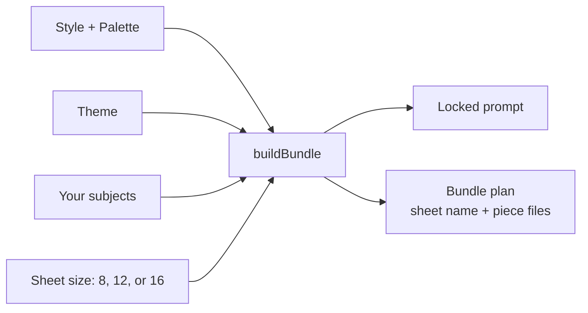

# Clipwright Studio

Clipwright Studio is a single-file prompt builder for planning matching clipart bundles. Pick a style, a color palette, a theme, and optionally your own subjects. The app writes one locked prompt that asks an image generator for a full sheet of matching pieces, plus a file-name plan for cutting them out.

It runs entirely in your browser. There is no install step, no server, and no network calls.

## Features

- **21 built-in styles**, plus a "Write my own" option for custom style descriptions
- **7 color palettes**, each with hex codes written into the prompt
- **5 themes** with suggested subjects (Nutcracker Christmas, Cozy books and coffee, Coastal summer, Autumn pumpkin patch, Garden tea party)
- **Sheet sizes of 8, 12, or 16 pieces**, laid out on a 4-column grid
- **Your own subjects first**, with the theme filling any open slots
- **Duplicate removal, length limits, and warnings** so the prompt stays clean
- **Bundle plan** listing a file name for every piece and a sheet name
- **"Let it pick for me"** to randomize style, palette, and theme
- **Built-in self-tests** that run when the page loads

## Quick start

1. Download `clipwright-studio.html`.
2. Open it in any modern web browser.
3. Choose your options, click **Build bundle**, and copy the prompt.
4. Paste the prompt into your image generator, then save the sheet under the name shown in the bundle plan.

## How it works



Subjects you enter come first. If you leave slots open, the theme fills them in order. The prompt then lists every piece with a number, so the image generator knows exactly what to draw and where.

## Running the self-tests

**In the browser:** the results appear at the bottom of the page each time it loads.

**From the command line** (requires Node.js):

```bash
node tests/run-tests.js
```

The runner loads the logic directly from `clipwright-studio.html`, so it always tests the shipped file. It exits with code `0` when every test passes and `1` when any test fails, which makes it usable in a CI workflow.

The suite covers:
- Every style, palette, and sheet size combination (441 checks)
- Grid and piece counts
- Subject handling: fill from theme, duplicates, overflow, and length limits
- Input validation for missing or blank fields
- File-name rules (unique, lowercase, no spaces)
- Prompt rules (no text, no borders, no overlap, palette codes included)
- Prompt length under the limit at maximum input

## Customizing

All content lives in the `CORE` section of `clipwright-studio.html`, between the `/*CORE-START*/` and `/*CORE-END*/` markers.

- **Add a style:** add an object with `name` and `desc` to the `STYLES` array.
- **Add a palette:** add an object with `name` and a `colors` array of hex codes to `PALETTES`.
- **Add a theme:** add an object with `name` and a `suggestions` array to `THEMES`. A theme needs **at least 16 suggestions** so that a 16-piece sheet can be filled when the user lists no subjects. The current test suite checks combinations against the first theme only, so run the tests after adding a theme and check the new theme's suggestion count yourself.

## Project structure

```
clipwright-studio/
├── clipwright-studio.html   # The app: markup, styles, core logic, and UI
├── tests/
│   └── run-tests.js         # Command-line self-test runner
└── README.md
```

## Limitations

- **Prompt-only.** The app writes prompts and does not generate images. You need your own image generator.
- **Output varies by generator.** Image tools do not always place pieces exactly where a numbered list asks. Review every sheet before using it.
- **Subject wording matters.** Short, concrete subjects such as "teacup" work better than abstract ones such as "cozy feeling."
- **Not tested on every browser.** The self-tests run in Node.js. The browser interface has been checked for logic, but not for every browser and screen size.

## Contributing

Issues and pull requests are welcome. Please run `node tests/run-tests.js` before submitting a change and include a test for any new behavior.

## License

No license has been chosen yet. Add a `LICENSE` file before publishing so others know how they may use, modify, and share the project.
